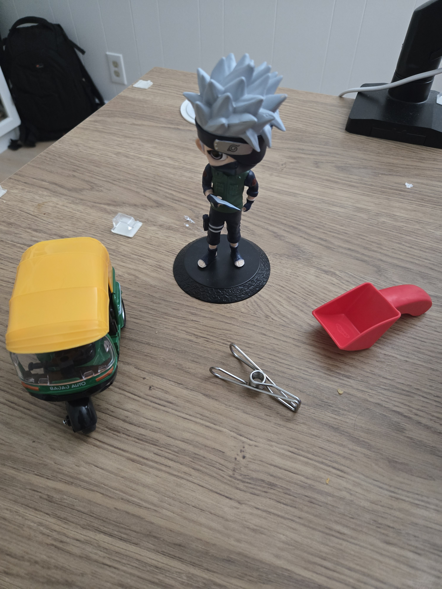

+++
date = '2026-08-18T21:14:00-07:00'
draft = false
title = 'How Far Can Appearance-Only Visual Memory Go? Evaluating SigLIP2 for Indoor Place Recognition'
tags = ["computer-vision", "place-recognition", "vision-language-models", "robotics"]
description = "A systematic evaluation of SigLIP2 as a visual memory backbone for indoor place recognition, probing how far appearance-only embeddings can take us before geometry becomes non-negotiable."
+++

To perform long horizon tasks, agents need memory that supports reasoning over time and reduces the search space. In robotics there is a quite a bit of work happening in spatial and episodic memory, most of which combines geometry, pose and tracking. In this post I'm asking a simple question: How far can a pure appearance based approach using a modern vision language embedding model like SigLIP, go for place recongition and basic memory under real object and viewpoint change?

## Overview

I test a lightweight online appearance based visual memory. Each image is embedded using [SigLIP2](https://huggingface.co/google/siglip2-base-patch16-512) model and either assigned to existing place cluster or used to start a new one. For a known place, we retrive previous observations and check for changes using [QwenVL 2B](https://huggingface.co/Qwen/Qwen3-VL-2B-Instruct) model.

Explicit non-goals: This system does not use camera pose, ego-motion, geometric verification, 3D structure, or persistent object identities. It is intentionally appearance-only.

## Dataset

To test this out, I create a small dataset with 6 different objects on 3 different surfaces - 2 wooden table and 1 marble like table. 
Each image contain a max of 4 objects, deliberately the objects are either removed or added and the images are taken from a few different viewpoints. A few images from the dataset are shown below.

Images are annotated with Place ID and a sequence of images are created to simulate a "robot" moving through space.

4. Evaluation & Results
Place Assignment

Recall@1 for correct place: 96% (25/26).
Single failure case: two different surfaces containing nearly identical object sets (red scoop + cube + metal clip). The embedding matched the objects more strongly than the place.

Similarity Behavior Along a Sequence

Consecutive SigLIP2 similarity stays high across many true place transitions → poor signal for detecting place changes.
Similarity to the first observation of a place decays under rearrangement (within-place drift).
Returning to a previous place produces variable recovery of similarity to the original anchor.

5. Analysis & Limitations

Global embeddings work reasonably for place recognition when places have distinct overall appearance.
They become brittle when scenes are object-centric and different places share similar objects.
Consecutive similarity is not a reliable transition detector.
Maintaining only a single anchor image per place is limited because of within-place drift.
These results highlight why geometry and instance tracking become necessary for more robust spatial memory.

6. Conclusion

A pure SigLIP2 appearance memory can achieve strong place assignment on a controlled indoor set, but fails in predictable object-dominated cases and provides weak transition signals.
Useful as a lightweight memory layer for high-level semantic context, but insufficient as a standalone solution for reliable robotic place recognition under change.
Clear next steps would involve hybrid appearance + geometry or instance-level association.
